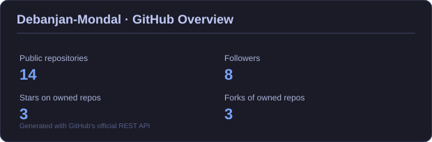

# 💫 About Me

I'm an Electronics and Communication Engineering student interested in electronics, programming, and practical engineering projects.

I enjoy experimenting with microcontrollers, sensors, and connected devices, along with developing software applications. I like learning by building projects, trying out new technologies, and understanding how hardware and software work together.

### 🔧 Interests
- **Embedded Systems & IoT:** ESP32, sensor integration, smart devices, home automation, and WLED controllers.
- **Electronics & Hardware:** Circuit design, PCB development, power supply circuits, and USB-C Power Delivery.
- **Software Development:** Web development, backend programming, databases, APIs, and cloud-connected applications.
- **Digital Design:** Digital logic, Verilog, and FPGA development.
- **RF & Communication Systems:** RF and microwave engineering, antennas, and electromagnetic simulations.
- **Scientific Computing:** Python-based data analysis, numerical simulations, and computational materials science.

### 🌱 Currently Learning

I'm working on strengthening my fundamentals in electronics and programming through academic and personal projects. I'm also exploring backend development, hardware prototyping, PCB design, and scientific simulation tools.

### 🤝 Collaboration

I'm open to collaborating on projects involving IoT, embedded systems, electronics, and software development. I enjoy exchanging ideas, learning from others, and experimenting with different approaches to engineering problems.

### ⚡ Beyond the Code

I like exploring ideas for everyday-use devices and finding ways to combine electronics, software, and automation into practical solutions. My goal is to keep learning, build useful projects, and develop a stronger foundation in engineering.

## 🌐 Socials

# 💻 Tech Stack

### Languages

### Web & Application Development

### Embedded Systems & Hardware

### Databases & Cloud

### Data Analysis & Development Tools

# 📊 GitHub Stats

---

*Learning, experimenting, and building one project at a time.*
